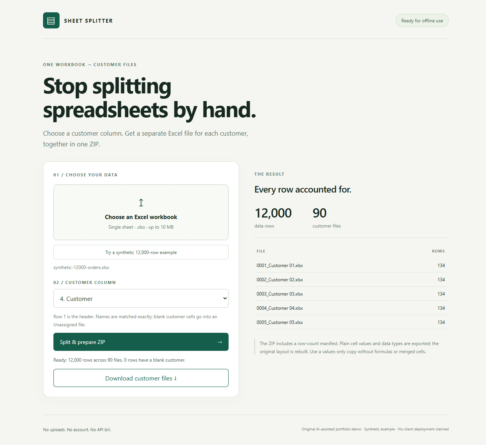

# Customer Sheet Splitter

Original AI-assisted portfolio demonstration by zrj3zZ. This is a synthetic example, not commissioned work, an accepted job or a client deployment.

Inspired by the publicly posted [PortModels app request: split one big Excel into a file per customer](https://portmodels.com/app-requests). No PortModels integration, partnership, funding or payout is claimed.

## Run

Serve this folder with Python 3:

    python -m http.server 8765 --bind 127.0.0.1

Open `http://127.0.0.1:8765/`. Click the synthetic example, choose Customer (column 4), split, then download the ZIP. A sample workbook and its independently checked output are in `examples/` after running the tests.

All processing takes place in a browser worker. No workbook is uploaded, no model or remote API is called, and there are no API charges. Libraries are included locally. The service worker caches only app assets, not selected workbooks or output files. After the initial successful load, the page can be reloaded offline. Clear site data to remove the asset cache.

## Data contract

- Exactly one sheet; row 1 is the header. Nonempty data rows retain their order within each customer file.
- Group names are exact and case-sensitive. Numeric 1 and text "1" are separate groups. Blank customer cells are retained in an Unassigned group.
- Every generated ZIP includes `manifest.json` with filenames, group identity and row counts. Indexed filenames prevent filesystem collisions and path traversal.
- Plain cell values (strings, numbers, booleans and dates) are exported to XLSX. Formatting is rebuilt; original styles, charts, macros and workbook logic are not preserved.
- Formulas, errors, hyperlinks, rich text, merged cells and multiple sheets are rejected. Save a plain values-only copy first. Cached formula results are not silently substituted.
- Limits: 10 MB input, 50,000 data rows, 128 columns, 500 groups. This prototype is for trusted workbooks; it is not a hardened parser for hostile ZIP files.

## Verify

No npm installation is needed:

    node --test test.js

Tests reopen each file in a 12,000-row / 90-customer ZIP and compare every exported row against the independently retained input fixture, checking customer isolation, IDs, types and manifest totals. Additional tests cover unsafe filenames, null/zero/false groups, formula-like strings, actual formulas, invalid inputs, merged cells and multiple sheets. `verification.json` records the actual runtime and measured split time; `test-results.txt` and `browser-verification.json` are evidence when present.

## Dependencies and rights

- ExcelJS **4.4.0**, MIT, obtained from the official npm package `exceljs@4.4.0`; browser build copied without running package scripts.
- JSZip **3.10.1**, used under its MIT option, copied from the bundled workspace runtime.
- Third-party license notices are in `vendor/`. Original demo code is MIT licensed.

Development, testing and documentation were AI-assisted. Local synthetic tests demonstrate these specific paths; they do not establish production reliability, mobile-device coverage, customer experience, or commercial deployment history.
